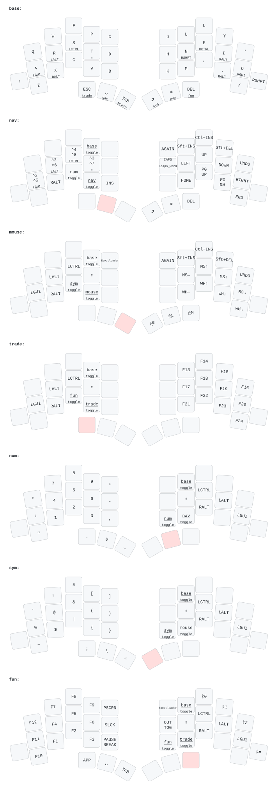

# Totem ZMK Configuration

Custom ZMK firmware configuration for the [GEIGEIGEIST Totem](https://github.com/GEIGEIGEIST/totem) split keyboard with split battery reporting enabled.

## Features

- **Miryoku Colemak layout** for the Totem 38-key split
- **Split battery reporting** - Central half fetches the peripheral battery level and proxies it to compatible hosts/apps
- **Optional ZMK Studio support** that can be re-enabled if needed
- **7-layer Miryoku stack**: Base, Nav, Mouse, Trade, Num, Sym, Fun
- **Tap-preferred homerow mods** and layer-tap thumbs
- **Mouse, media, Bluetooth, and output controls**

## Layers

### BASE
Colemak alpha layer with homerow mods and Miryoku thumb keys.

### NAV
Navigation, selection shortcuts, arrows, paging, and caps word.

### MOUSE
Mouse movement, wheel controls, and mouse buttons.

### TRADE
Dedicated right-hand function layer with `F13` through `F24`.

### NUM
Number pad style layer with brackets and arithmetic symbols.

### SYM
Primary symbol layer for programming punctuation.

### FUN
Function keys, print screen, pause, and app/menu key.

## Keymap Visualization



## Installation

1. Fork this repository
2. Enable GitHub Actions in your fork
3. Modify `config/totem.keymap` as needed
4. Install the local pre-push hook with `git config core.hooksPath .githooks`
5. Push changes to trigger automatic firmware build
6. Download firmware from Actions artifacts
7. Flash `totem_left-seeeduino_xiao_ble-zmk.uf2` to left half
8. Flash `totem_right-seeeduino_xiao_ble-zmk.uf2` to right half

### Dongle mode

A third XIAO BLE can act as a USB dongle (central), with both halves as peripherals.
That way the halves only talk BLE to the dongle, which saves battery on the left half.

1. Flash `settings_reset-seeeduino_xiao_ble-zmk.uf2` to **all three** boards (dongle, left, right) to clear old pairings
2. Flash `totem_dongle-seeeduino_xiao_ble-zmk.uf2` to the dongle
3. Flash `totem_left_peripheral-seeeduino_xiao_ble-zmk.uf2` to the left half
4. Flash `totem_right-seeeduino_xiao_ble-zmk.uf2` to the right half
5. Plug the dongle into the computer and power on both halves; they pair to it automatically

To go back to standalone mode, settings-reset all boards and flash the normal left/right firmware.

#### Battery levels on macOS (TotemBattery)

macOS can't show a USB keyboard's battery, so the dongle also exposes a small USB serial port
and writes `ZMKBAT <slot0> <slot1> <connected>` lines to it every 5 s (`src/battery_serial.c`).
The menu bar app in `macos/TotemBattery` reads that port and shows `L 85%  R 72%`.

1. Build it: `macos/TotemBattery/build.sh` (needs the Xcode command line tools)
2. Move `macos/TotemBattery/TotemBattery.app` to `/Applications` and open it
3. Optional: enable **Open at Login** from its menu

Slot 0 is whichever half paired with the dongle first, so after a settings reset turn on the
**left** half first. If the halves show up reversed, use **Swap Left/Right** in the menu.
A ⚠︎ means one half isn't connected to the dongle; the title blinks red when a half is at 15% or below.

## Local Keymap Render Check

Use `scripts/render-keymap.sh` to regenerate the checked-in keymap artifacts:

- `keymap-drawer/totem.yaml`
- `keymap-drawer/totem.svg`
- `totem-keymap.svg`

After running `git config core.hooksPath .githooks` once in your clone, every `git push` will run that render step first and abort if the generated files are out of date.

## ZMK Studio

ZMK Studio is currently disabled to avoid the extra firmware overhead when it is not in use.

To re-enable it later:

- Uncomment `CONFIG_ZMK_STUDIO=y` in `config/totem.conf`
- Uncomment `snippet: studio-rpc-usb-uart` for `totem_left` in `build.yaml`
- Plug in the **left** half over USB when using Studio
- Make sure the keyboard output is set to USB when connecting with Studio over USB

## Hardware

- **Keyboard:** GEIGEIGEIST Totem (38-key split)
- **Controller:** Seeeduino XIAO BLE (nRF52840)
- **Firmware:** ZMK with Studio support

## Special Features

### Layout
- Miryoku Totem layout matching the rendered reference image
- Shift-modified Bluetooth keys clear the selected profile
- Shift-modified output toggle forces USB output

### Battery Monitoring
Configured with ZMK split battery fetching and proxying so compatible hosts/apps can read both halves.

Notes:

- The left half is the split central and is the Bluetooth device that connects to the host.
- Native host battery UIs often still show only one percentage even when split battery proxying is enabled.
- To reliably see both halves, use a host app that reads the proxied split battery data instead of relying on the default macOS Bluetooth battery indicator.

### macOS: Seeing Both Battery Levels

On macOS, ZMK documents host support for multiple battery values as undefined, and notes that most hosts only show the main battery in the native UI.

For macOS, the practical way to view both halves is to use a BLE battery utility that understands ZMK split battery proxying, such as `zmk-battery-center`.

Recommended flow:

1. Rebuild and flash both halves after this config change.
2. Remove the existing Bluetooth pairing for the keyboard in macOS.
3. Clear keyboard bonds with `BT_CLR_ALL`, then pair the keyboard again.
4. Install and open `zmk-battery-center`.
5. Grant the app Bluetooth permission in macOS if prompted.
6. Confirm the app shows separate central and peripheral battery levels.

## Changing the Keyboard Name

To change the Bluetooth device name:

1. Edit `config/totem.conf` and set:
   ```
   CONFIG_ZMK_KEYBOARD_NAME="Your Custom Name"
   ```

2. Build the firmware (GitHub Actions will create 3 files including `settings_reset`)

3. Flash the firmware:
   - Flash `settings_reset-seeeduino_xiao_ble-zmk.uf2` to both halves 
   - Flash `totem_left-seeeduino_xiao_ble-zmk.uf2` to left half
   - Flash `totem_right-seeeduino_xiao_ble-zmk.uf2` to right half

4. Clear Bluetooth bonds on the keyboard using `BT_CLR_ALL`

Note: The settings reset is required because the keyboard name is stored in persistent memory.
